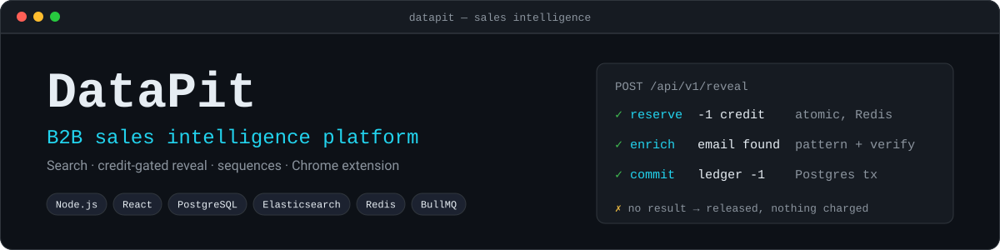
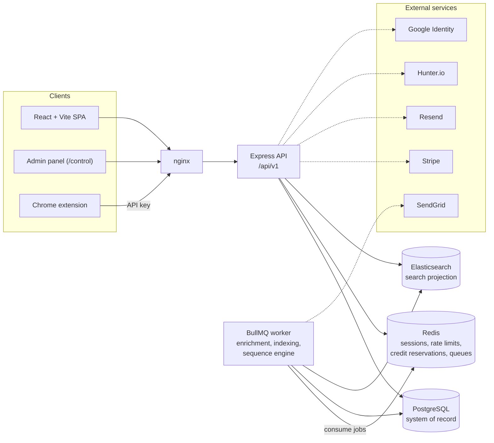
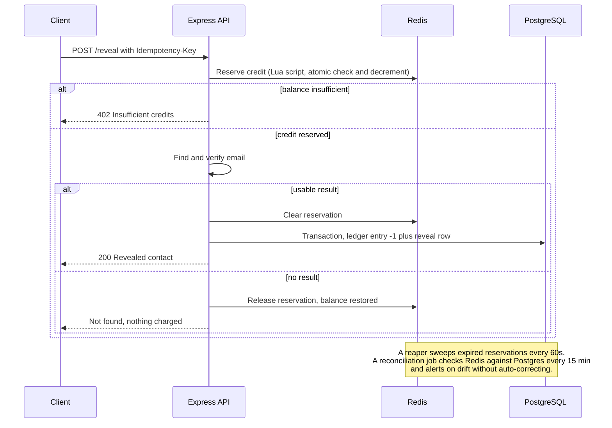

<div align="center">



<br>

[](https://datapit.io)


</div>

**DataPit** is a B2B contact and company data platform in the vein of Apollo.io and Slintel. Teams search people and companies with faceted filters, **reveal verified work emails and phone numbers against a credit balance**, organize prospects into lists, and run **multi-step email sequences**. A Chrome extension surfaces the same data on LinkedIn, Sales Navigator, Gmail and CRM pages.

It runs in production at [datapit.io](https://datapit.io). This repository is the full source: an Express API, a BullMQ worker, a React SPA and the Chrome extension.

> **Built vs. planned.** [`docs/FEATURES.md`](docs/FEATURES.md) is the file-by-file record of what is implemented, what is simulated until a provider key is configured, and what is deliberately not built (CRM sync, intent scoring, technographics). Treat it as the source of truth.

---

## Contents

[Highlights](#highlights) · [Architecture](#architecture) · [The credit flow](#the-credit-flow) · [Chrome extension](#chrome-extension) · [Tech stack](#tech-stack) · [Quick start](#quick-start) · [Repository layout](#repository-layout) · [Quality and CI](#quality-and-ci) · [Security and compliance](#security-and-compliance) · [Integrations](#integrations) · [Documentation](#documentation)

---

## Highlights

| Area | What it does |
|---|---|
| **People and company search** | Faceted Elasticsearch queries (title, seniority, department, location, industry, headcount, tech stack, email status), saved searches, bulk actions. Results hydrate from Postgres and **contact details stay masked until revealed**. |
| **Credit-gated reveal** | Email and phone reveal that spends credits atomically, with idempotency keys, auto-refund on no result, and a reaper plus reconciliation job that keep Redis and Postgres balances in agreement. |
| **Company detail** | Firmographics, tech stack and contacts. The first view by a workspace is charged, repeat views are free. |
| **Lists** | Named lists of contacts and companies with credit-gated CSV export. |
| **Sequences** | `EMAIL` and `WAIT` steps, enroll, pause, resume and unenroll, a 60-second worker tick, per-step funnel analytics, and a suppression list fed by bounce and unsubscribe webhooks. |
| **Billing** | Stripe Checkout for one-off top-ups and per-seat plan subscriptions. Stripe keys are entered in the admin panel and stored AES-256-GCM encrypted, not in env vars. |
| **Accounts and teams** | Email/password and Google sign-in, email verification, password reset, seat-limited team invites, and `OWNER` / `ADMIN` / `MEMBER` roles per workspace. |
| **Support** | Tenant-side ticketing plus a separate `/control` admin panel with audit log, import approval and promotional broadcasts. |
| **Onboarding** | A getting-started checklist detected from real activity, with credit rewards, a ⌘K command palette and designed empty states. |
| **Observability** | Prometheus `/metrics`, structured logs and OpenTelemetry instrumentation. |

---

## Architecture



- **PostgreSQL** is the source of truth (Prisma schema in [`backend/prisma/schema.prisma`](backend/prisma/schema.prisma)).
- **Elasticsearch** holds a denormalized projection for fast faceted search. Rows are hydrated from Postgres after the query and masked before they are returned.
- **Redis** backs sessions and refresh tokens, rate limiting, credit reservations and the BullMQ queues.
- **The worker** handles asynchronous enrichment, search (re)indexing and the time-based sequence engine.
- It is deliberately **one Express monolith plus one worker process**, not microservices. The deployed shape is in [`docs/08-deployment.mermaid`](docs/08-deployment.mermaid).

More diagrams live in [`docs/`](docs): data model, enrichment flow, search flow, user journey, sequence engine and the credit state machine.

---

## The credit flow

Revealing a contact is the product's core money mechanic, so it is built to be safe under concurrency: a balance can never be overspent by parallel requests.



The invariant, always true: `monthlyCreditGrant + SUM(ledger.delta) == available balance + active reservations`. A repeated idempotency key replays the cached response instead of charging again. The full state machine is [`docs/07-credits-state.mermaid`](docs/07-credits-state.mermaid).

---

## Chrome extension

[`extension/`](extension) is a plain Manifest V3 extension with no build step. It looks people up where sales work happens:

- **LinkedIn profiles and Sales Navigator leads**: matched automatically. Found contacts can be revealed, unknown profiles are queued for the data team, and title changes are reported.
- **Gmail, Google Calendar, HubSpot and Salesforce**: reads only the email addresses of people in the open thread, event or record (never message text) and lists who is in DataPit.
- **Any company website**: the toolbar popup looks up the site's domain.

Install and local-development steps are in [`extension/README.md`](extension/README.md).

---

## Tech stack

| Layer | Technology |
|---|---|
| **API and worker** | Node.js 20, Express, Prisma, BullMQ, ioredis, zod, Stripe SDK |
| **Frontend** | React 18, Vite, Redux Toolkit (RTK Query), React Router, Tailwind CSS, prerendered marketing and content pages |
| **Data** | PostgreSQL 16, Elasticsearch 8, Redis 7 |
| **Extension** | Chrome Manifest V3, shadow-DOM UI |
| **Quality** | Vitest, ESLint, Prettier, Husky and lint-staged |
| **Ops** | Docker Compose, nginx, pm2, systemd units, Prometheus, OpenTelemetry |

---

## Quick start

### Docker (everything at once)

```bash
docker compose up --build
# once the api and elasticsearch containers are healthy, in another terminal:
docker compose exec api npm run prisma:migrate   # create tables
docker compose exec api npm run seed             # sample data and a demo user
```

| Service | URL |
|---|---|
| Web app | <http://localhost:5173> |
| API | <http://localhost:4000/api/v1> |

Demo login (local seed data only): `demo@datapit.io` / `demo1234`

### Manual development

Prerequisites: Node 20+, PostgreSQL, Redis and Elasticsearch 8 running locally.

```bash
# Backend
cd backend
cp .env.example .env          # set DATABASE_URL, REDIS_URL, ELASTICSEARCH_URL
npm install
npm run prisma:migrate
npm run seed                  # 40 companies, contacts and the demo user
npm run dev                   # API on :4000
npm run worker                # background jobs, in a second terminal

# Frontend
cd ../frontend
npm install
npm run dev                   # Vite on :5173, proxies /api to :4000
```

Everything runs locally with no third-party accounts: each external integration falls back to a logged, simulated response until you configure a key (see [Integrations](#integrations)).

---

## Repository layout

```
signalbase/
├── backend/
│   ├── prisma/                 # schema and migrations
│   └── src/
│       ├── config/             # env, db, redis, elasticsearch, metrics, logger
│       ├── middleware/         # auth, rbac, rate limit, idempotency, credit reservation
│       ├── services/           # search, credits, reveal, sequences, billing, privacy
│       ├── controllers/        # request handlers
│       ├── routes/             # /api/v1 router
│       ├── jobs/               # BullMQ queues, indexer, worker, processors
│       └── validators/         # zod schemas
├── frontend/
│   └── src/                    # api slices, store, layouts, components, pages
├── extension/                  # Chrome extension (Manifest V3)
├── deploy/                     # nginx, systemd, backup and health-check scripts
├── docs/                       # diagrams, data model, API spec, feature accounting
├── scripts/
├── docker-compose.yml          # postgres, redis, elasticsearch, api, worker, web
├── ARCHITECTURE.md
├── RUNBOOK.md
└── TODO.md
```

---

## Quality and CI

```bash
cd backend  && npm run lint && npm run format && npm test
cd frontend && npm run lint && npm run format && npm test
```

[`.github/workflows/ci.yml`](.github/workflows/ci.yml) runs on every push to `main` and every pull request:

- **Secrets scan** with gitleaks over the full history
- **Backend** against real Postgres, Redis and Elasticsearch service containers: `npm audit`, lint, Prettier, migrations, tests
- **Frontend**: `npm audit`, lint, Prettier, tests
- **Container scan** of both images with Trivy (high and critical findings)

---

## Security and compliance

- **Auth**: short-lived in-memory access tokens, `httpOnly` refresh cookies with rotation and replay detection, enumeration-safe password reset.
- **Abuse controls**: Redis token-bucket rate limits on login, register, reveal, exports, uploads and per-workspace create actions.
- **Money safety**: idempotency keys on reveal, reserve → commit / release credit accounting, and a drift-detecting reconciliation job.
- **Secrets**: admin-entered Stripe keys encrypted with AES-256-GCM, and gitleaks in CI.
- **Privacy**: a public GDPR/CCPA opt-out and erasure endpoint that redacts matching contacts and blocks future guessed reveals.
- **Auditability**: an admin audit log records who suspended an account, changed a plan, granted credits, saved payment settings or approved an import.

---

## Integrations

Every provider has a real code path and a simulated fallback, so the app runs end to end with zero external accounts.

| Integration | Live when | Otherwise |
|---|---|---|
| Hunter.io email verification | `EMAIL_VERIFIER_API_KEY` set | Reveal proceeds as unchecked |
| SendGrid sequence sends | `ESP_API_KEY` and `ESP_FROM_EMAIL` set | Logs a simulated message id |
| Resend transactional mail | `RESEND_API_KEY` set | Logs instead of sending |
| Stripe checkout and subscriptions | Keys saved in `/control/settings` | Checkout returns a simulated URL |
| Google Sign-In | `GOOGLE_CLIENT_ID` and `VITE_GOOGLE_CLIENT_ID` set | `POST /auth/google` returns 503 |

CRM sync, intent scoring, technographics and sequence A/B testing are not built. See [`docs/FEATURES.md`](docs/FEATURES.md) and [`TODO.md`](TODO.md).

---

## Documentation

| Document | Contents |
|---|---|
| [`ARCHITECTURE.md`](ARCHITECTURE.md) | Master architecture write-up |
| [`docs/FEATURES.md`](docs/FEATURES.md) | What is built, simulated and not built |
| [`docs/DATA-MODEL.md`](docs/DATA-MODEL.md) | Entities and relationships |
| [`docs/API-SPEC.md`](docs/API-SPEC.md) | REST API reference |
| [`docs/UX-ROADMAP.md`](docs/UX-ROADMAP.md) | In-app UX overhaul plan and status |
| [`docs/EXTENSION-PLAN.md`](docs/EXTENSION-PLAN.md) | Chrome extension design |
| [`RUNBOOK.md`](RUNBOOK.md) | Operations, deploys and incident notes |
| [`TODO.md`](TODO.md) | Open work, by priority |

Each `.mermaid` file in [`docs/`](docs) renders directly on GitHub.
